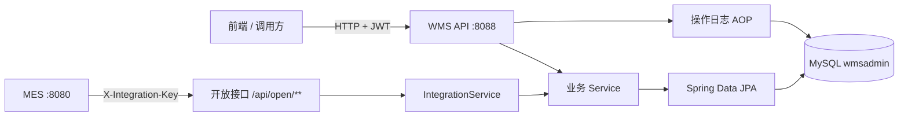
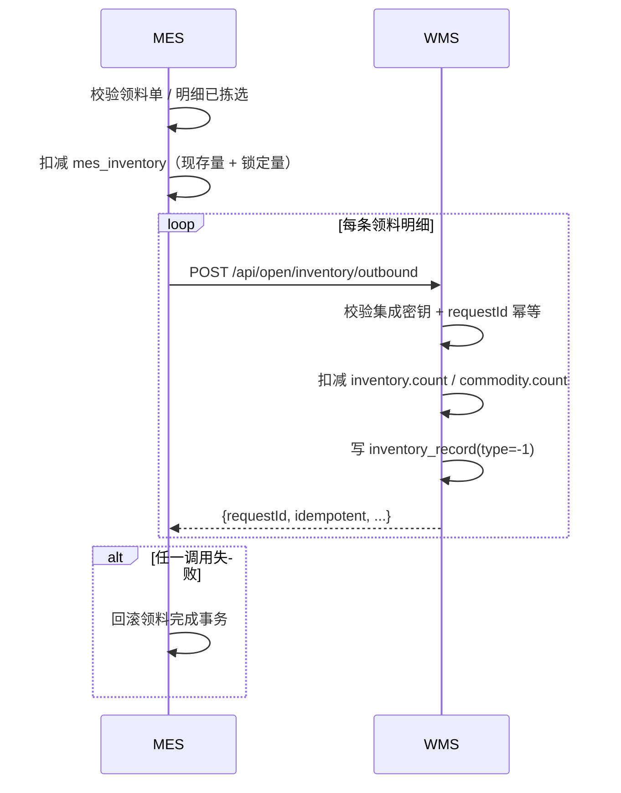
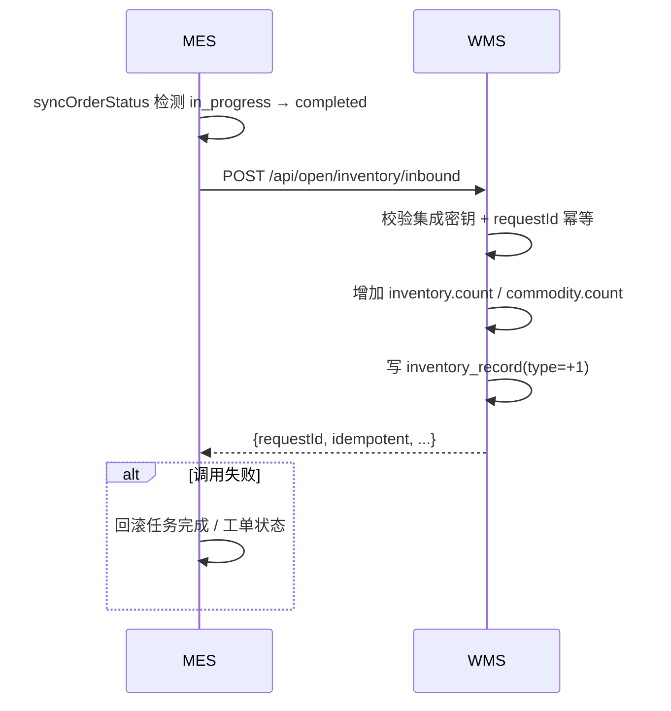

# WMS — 仓储管理系统后端

> Spring Boot 2.7 · Java 11 · Spring Data JPA · MySQL · Spring Security + JWT
>
> 面向中小型仓储场景的后端服务，覆盖商品、仓库、库存、出入库、配送、销售、员工与操作日志，并通过开放接口与 MES 系统联动。

## 1. 项目简介

WMS（Warehouse Management System）负责仓库侧的主数据与库存账：

- 维护商品、仓库、库存、员工、司机、车辆等基础数据。
- 记录每一次入库、出库，形成可查询的库存流水。
- 管理销售单与配送单，配送时占用司机和车辆。
- 提供登录日志、系统操作日志与角色权限控制。
- 作为**库存主账**，向 MES 提供领料出库、完工入库两个集成接口。

仓库当前定位为可运行的实训 / 演示级系统，业务链路完整，生产使用前仍需补齐权限细粒度、批次库存、对账与可观测性。

## 2. 功能全景

| 模块 | 能力 |
| --- | --- |
| 管理员与权限 | 超管初始化、密码登录、邮箱验证码登录、管理员 CRUD、角色分配 |
| 商品管理 | 商品 CRUD、按名称检索、商品编码映射 |
| 仓库管理 | 仓库 CRUD、仓库编码映射 |
| 库存管理 | 库存查询、按仓库/商品查询、入库、出库、出入库排行统计 |
| 配送管理 | 配送单创建、司机/车辆可用性校验、配送占用状态 |
| 销售管理 | 销售单创建、按客户检索、回款标记 |
| 员工管理 | 员工 CRUD |
| 司机/车辆 | 司机与车辆 CRUD、配送状态 |
| 日志 | 登录日志、系统操作日志、日志检索与清理 |
| 系统集成 | MES 领料出库、MES 完工入库、幂等与集成密钥校验 |

## 3. 系统架构



分层：

```
Controller → Service/Impl → Repository(JpaRepository) → Entity → MySQL
```

- `GlobalResponseHandler` 统一封装 `{code, status, msg, data}`。
- `GlobalExceptionHandler` 统一处理业务异常。
- `@Log` + AOP 自动记录系统操作日志。
- `JwtAuthorizationFilter` 解析 `Authorization` 请求头。
- `IntegrationKeyFilter` 校验 `/api/open/**` 的 `X-Integration-Key`。

## 4. 技术栈

| 类别 | 选型 |
| --- | --- |
| 语言 / 运行时 | Java 11 |
| 框架 | Spring Boot 2.7.2、Spring Security |
| 持久层 | Spring Data JPA、Hibernate |
| 数据库 | MySQL 8 |
| 鉴权 | JWT（jjwt 0.9.1）+ 方法级 `@PreAuthorize` |
| 邮件 | Spring Mail（QQ SMTP，可配置） |
| JSON | Jackson |
| 构建 | Maven |
| 其他 | Lombok、AOP、UUID 主键 |

## 5. 核心数据模型

| 表 | 说明 |
| --- | --- |
| `admin` | 管理员，密码 BCrypt 存储，`roles` 分号分隔 |
| `commodity` | 商品，`code` 用于和 MES 物料编码映射 |
| `warehouse` | 仓库，`code` 用于和 MES 仓库编码映射 |
| `inventory` | 仓库 + 商品的聚合库存，`count` 为现存数量 |
| `inventory_record` | 入库/出库流水，`type=+1/-1`，含批次与来源单号 |
| `distribution` | 配送单，关联司机与车辆 |
| `sale` | 销售单 |
| `employee` | 员工 |
| `driver` / `vehicle` | 司机 / 车辆，`driving` 表示占用 |
| `login_log` | 登录日志 |
| `system_log` | 系统操作日志 |
| `code` | 邮箱验证码，15 分钟有效 |

> WMS 当前按「仓库 + 商品」聚合记账，不按批次拆分库存。批次号只记录在 `inventory_record` 中用于追溯。

## 6. 权限模型

| 角色 | 说明 |
| --- | --- |
| `ROLE_SUPER_ADMIN` | 超级管理员，拥有全部权限 |
| `ROLE_ADMIN` | 操作员 |
| `ROLE_COMMODITY` | 商品相关 |
| `ROLE_EMPLOYEE` | 员工相关 |
| `ROLE_SALE` | 销售相关 |
| `ROLE_WAREHOUSE` | 仓库相关 |

JWT 中携带角色列表，`@PreAuthorize` 在方法级校验。公开接口只有登录、首次初始化、验证码发送和 `/api/open/**`。

## 7. 与 MES 的联动

### 7.1 设计原则

| 决策 | 说明 |
| --- | --- |
| 集成方式 | REST 同步调用，不共享数据库 |
| 库存主账 | WMS 是仓库实物账，MES 本地库存是车间执行镜像 |
| 幂等 | MES 生成稳定的 `requestId`，WMS 唯一索引去重 |
| 鉴权 | `X-Integration-Key` 共享密钥 |
| 失败处理 | WMS 调用失败 → MES 业务事务回滚；重试依赖幂等键 |
| 数据映射 | 优先 ID，其次 `code`，最后名称 |

MES 与 WMS 使用不同技术栈（MES：Spring Boot 3 / Java 17；WMS：Spring Boot 2.7 / Java 11），因此通过 HTTP 契约集成，不共享依赖。

### 7.2 领料出库

MES 领料单完成时，先扣减 MES 本地库存，再逐条调用 WMS 出库。



- `requestId`：`MES-PICKLIST-{pickListId}-ITEM-{detailId}`
- 来源：`source_type=MES_PICK_LIST`
- 批次：`batch_no` 只落 WMS 流水

### 7.3 完工入库

MES 工单所有任务完成、状态首次变为 `completed` 时，把成品推入 WMS 成品仓。



- `requestId`：`MES-ORDER-{orderId}-FINISHED-IN`
- 数量：`production_order.completed_quantity`
- 成品仓：MES 配置 `mes.wms.finished-goods-warehouse-code`
- 来源：`source_type=MES_PRODUCTION_ORDER`

### 7.4 开放接口

| 接口 | 用途 |
| --- | --- |
| `GET /api/open/ping` | 连通性检查 |
| `POST /api/open/inventory/outbound` | 领料出库 |
| `POST /api/open/inventory/inbound` | 完工入库 |

请求头：

```
X-Integration-Key: <integration.api-key>
```

请求体：

```json
{
  "requestId": "MES-PICKLIST-1001-ITEM-2001",
  "commodityCode": "M-DEMO-001",
  "commodityName": "演示原料",
  "warehouseCode": "WH01",
  "warehouseName": "原料仓",
  "quantity": 10,
  "batchNo": "DEMO-2026-001",
  "sourceType": "MES_PICK_LIST",
  "sourceNo": "PL-2026-0001",
  "sourceItemNo": "2001",
  "description": "MES领料单 PL-2026-0001 明细 2001"
}
```

重复提交同一 `requestId`：不重复扣减/增加库存，返回首次结果且 `idempotent=true`。

### 7.5 字段映射

| MES | WMS |
| --- | --- |
| `material.material_code` | `commodity.code` |
| `warehouse_location.warehouse_code` | `warehouse.code` |
| `production_order.product_code` | `commodity.code`（成品） |
| `picked_quantity` / `completed_quantity` | `quantity`（正整数） |
| `batch_number` / `order_code` | `batch_no` |
| `pick_list_code` / `order_code` | `source_no` |
| `pick_list_detail.id` / `order.id` | `source_item_no` |

### 7.6 集成配置

WMS：

```yaml
integration:
  api-key: ${INTEGRATION_API_KEY:mes-wms-dev-key}
```

MES：

```yaml
mes:
  wms:
    enabled: true
    base-url: http://localhost:8088
    api-key: mes-wms-dev-key
    finished-goods-warehouse-code: FG01
```

完整协议、失败语义和联调步骤见 [WMS ↔ MES 集成文档](docs/WMS_MES_INTEGRATION.md)。

## 8. API 一览

| 前缀 | 说明 |
| --- | --- |
| `/api/admin` | 登录、初始化、管理员管理 |
| `/api/commodity` | 商品管理 |
| `/api/warehouse` | 仓库管理 |
| `/api/inventory` | 库存查询、入库/出库、统计 |
| `/api/distribution` | 配送管理 |
| `/api/sale` | 销售管理 |
| `/api/employee` | 员工管理 |
| `/api/driver` | 司机管理 |
| `/api/vehicle` | 车辆管理 |
| `/api/loginlog`、`/api/systemlog` | 日志 |
| `/api/role` | 角色枚举 |
| `/api/open/**` | MES 集成接口 |

## 9. 快速开始

### 9.1 准备 MySQL

创建数据库 `wmsadmin`，或使用 JDBC URL 中的 `createDatabaseIfNotExist=true` 自动创建。表结构由 Hibernate `ddl-auto=update` 生成。

已有数据库升级密码列：

```sql
ALTER TABLE admin MODIFY COLUMN password VARCHAR(100) NOT NULL;
```

### 9.2 配置环境变量

| 变量 | 默认值 | 说明 |
| --- | --- | --- |
| `DB_URL` | `jdbc:mysql://localhost:3306/wmsadmin?...` | MySQL 连接 |
| `DB_USERNAME` | `root` | 数据库账号 |
| `DB_PASSWORD` | `root` | 数据库密码 |
| `JWT_SECRET` | 开发默认值 | JWT 签名密钥，生产必须覆盖 |
| `INTEGRATION_API_KEY` | `mes-wms-dev-key` | MES 集成密钥 |
| `ADMIN_INIT_TOKEN` | 空 | 首次创建超管的口令，未配置则禁止初始化 |
| `CORS_ALLOWED_ORIGINS` | `http://localhost:3000,http://localhost:8080` | 允许的前端来源 |
| `MAIL_HOST` / `MAIL_USERNAME` / `MAIL_PASSWORD` | 空 / 空 / 空 | 验证码邮件 |

### 9.3 启动

```bash
mvn spring-boot:run
```

默认端口 `8088`。

### 9.4 初始化超级管理员

```bash
curl -X POST http://localhost:8088/api/admin/init \
  -H "Content-Type: application/json" \
  -H "X-Init-Token: $ADMIN_INIT_TOKEN" \
  -d '{"email":"admin@example.com","password":"change-me"}'
```

密码以 BCrypt 存储，接口响应不会返回密码字段。系统已有超管后，`/api/admin/init` 会拒绝再次初始化。

### 9.5 登录

```bash
curl -X POST "http://localhost:8088/api/admin/login?type=password" \
  -H "Content-Type: application/json" \
  -d '{"email":"admin@example.com","password":"change-me"}'
```

后续请求携带：

```
Authorization: <登录返回的 token>
```

## 10. 安全设计

已实现：

- 管理员密码 BCrypt 哈希；兼容历史明文密码，登录成功后自动升级。
- 密码字段 `WRITE_ONLY`，不会在响应中泄露哈希。
- 验证码使用 `SecureRandom` 生成 6 位随机数，15 分钟有效，邮件发送成功后才落库。
- 首次初始化必须携带 `X-Init-Token`，且只能执行一次。
- 集成接口使用 `X-Integration-Key`，密钥比较使用常量时间比较。
- CORS 默认只允许本地前端来源，可通过环境变量配置。
- 敏感配置全部走环境变量；仓库不包含本地账号文件与演示 SQL。
- 已移除 fastjson，统一使用 Jackson。
- JWT 解析失败、过期、签名错误统一按无效令牌处理。

仍需注意：

- 部分控制器没有方法级 `@PreAuthorize`，公开部署前应按角色补齐。
- 验证码发送接口没有频率限制，生产环境应加限流。
- 库存扣减已使用数据库条件更新，但跨系统一致性仍依赖 MES 重试与幂等，未实现独立对账任务。
- 邮件验证码登录依赖 SMTP，未配置邮箱时该登录方式不可用。

## 11. 目录结构

```
src/main/java/com/example/api
├── annotation      # @Log、@DisableBaseResponse
├── aspect          # 操作日志切面
├── controller      # REST 接口
├── exception       # 业务异常
├── handler         # 全局响应/异常处理
├── model           # entity / dto / vo / enums / support
├── repository      # Spring Data JPA
├── security        # JWT、集成密钥、Spring Security 配置
├── service         # 业务接口与实现
├── task            # 启动任务
└── utils           # JWT、时间、IP、随机数等
```

## 12. 文档

- [WMS ↔ MES 集成文档](docs/WMS_MES_INTEGRATION.md)
