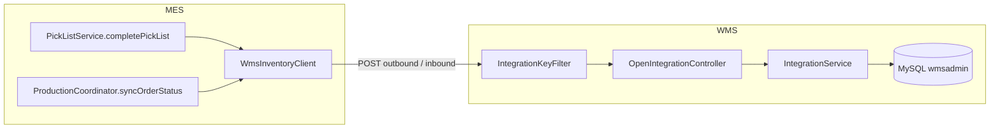
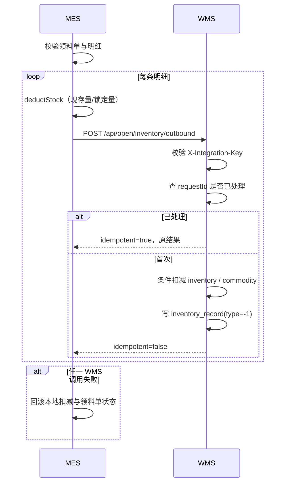
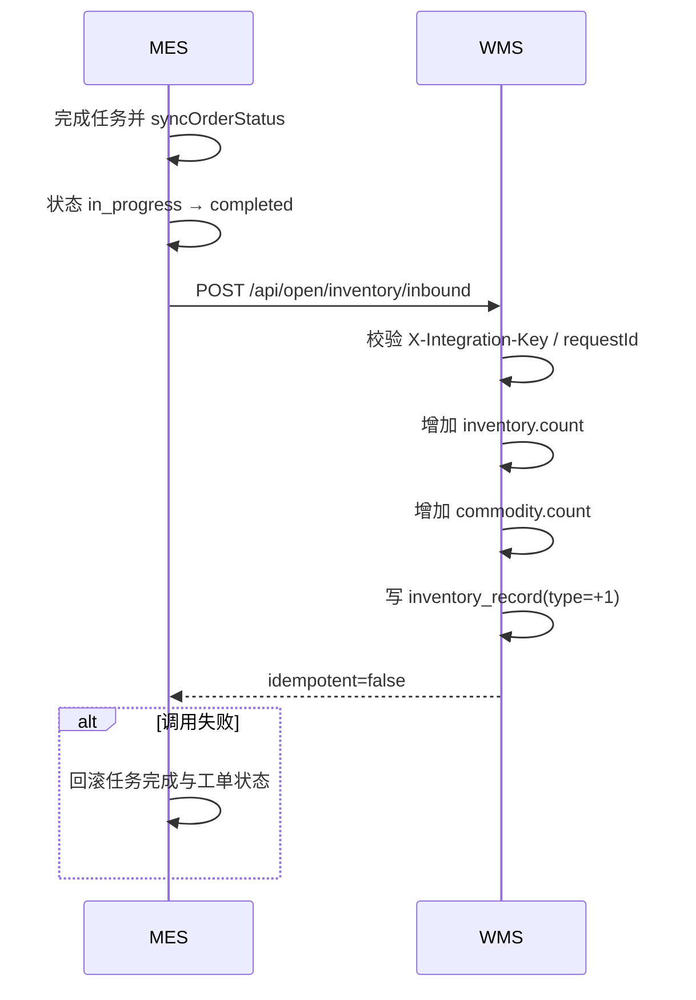

# WMS ↔ MES 集成文档

## 1. 目标

把仓库系统（WMS）与制造执行系统（MES）的库存动作连起来：

| 方向 | 业务动作 | 触发点 | WMS 动作 |
| --- | --- | --- | --- |
| MES → WMS | 领料出库 | MES 领料单完成 | 扣减成品/原料库存，写出库流水 |
| MES → WMS | 完工入库 | MES 工单首次完成 | 增加成品库存，写入库流水 |

集成后 WMS 是**库存主账**，MES 本地库存是车间执行镜像。

## 2. 设计决策

| 决策 | 原因 |
| --- | --- |
| REST 同步调用 | 两个系统技术栈不同（Java 11 / Boot 2.7 与 Java 17 / Boot 3），HTTP 契约最直接 |
| 不共享数据库 | 避免绕过业务校验、强耦合 |
| `requestId` 幂等 | 网络超时、MES 事务回滚后重试不会重复扣减/增加 |
| `X-Integration-Key` | 服务间轻量鉴权，不引入完整 OAuth2 |
| 失败即回滚 MES 事务 | 保证 MES 单据状态与 WMS 库存尽量一致 |
| 编码优先映射 | WMS 新增 `commodity.code`、`warehouse.code`，与 MES 主数据编码对齐 |

## 3. 总体链路



## 4. 领料出库

### 4.1 触发条件

`POST /api/picklist/{id}/complete`：

1. 领料单状态必须为 `picking`。
2. 所有明细状态必须为 `picked`。
3. 逐条扣减 MES `mes_inventory` 的现存量与锁定量。
4. 逐条调用 WMS 出库接口。

### 4.2 时序



### 4.3 幂等键

```
MES-PICKLIST-{pickListId}-ITEM-{pickListDetailId}
```

WMS `inventory_record.request_id` 唯一索引。重复调用返回首次记录，`idempotent=true`。

## 5. 完工入库

### 5.1 触发条件

MES `syncOrderStatus` 汇总工单下所有任务：

- 所有任务状态为 `completed`。
- 工单状态从非 `completed` 首次变为 `completed`。
- `completed_quantity > 0`。
- 产品编码非空。

满足后调用 WMS 入库。

### 5.2 时序



### 5.3 幂等键

```
MES-ORDER-{orderId}-FINISHED-IN
```

只在工单首次完成时触发；重复同步不会重复入库。

## 6. 接口契约

### 6.1 鉴权

所有 `/api/open/**` 请求必须携带：

```
X-Integration-Key: <integration.api-key>
```

WMS 配置：

```yaml
integration:
  api-key: ${INTEGRATION_API_KEY:mes-wms-dev-key}
```

密钥错误返回 HTTP 401。

### 6.2 出库

`POST /api/open/inventory/outbound`

```json
{
  "requestId": "MES-PICKLIST-1001-ITEM-2001",
  "commodityId": null,
  "commodityCode": "M-DEMO-001",
  "commodityName": "演示原料",
  "warehouseId": null,
  "warehouseCode": "WH01",
  "warehouseName": "原料仓",
  "quantity": 10,
  "batchNo": "DEMO-2026-001",
  "sourceType": "MES_PICK_LIST",
  "sourceNo": "PL-2026-0001",
  "sourceItemNo": "2001",
  "description": "MES领料单 PL-2026-0001 明细 2001"
}
```

响应：

```json
{
  "code": 200,
  "status": true,
  "msg": null,
  "data": {
    "requestId": "MES-PICKLIST-1001-ITEM-2001",
    "recordId": "wms-record-uuid",
    "commodityId": "wms-commodity-uuid",
    "warehouseId": "wms-warehouse-uuid",
    "quantity": 10,
    "batchNo": "DEMO-2026-001",
    "idempotent": false
  }
}
```

### 6.3 入库

`POST /api/open/inventory/inbound`

请求字段与出库一致：

```json
{
  "requestId": "MES-ORDER-9001-FINISHED-IN",
  "commodityCode": "P-DEMO-001",
  "warehouseCode": "FG01",
  "quantity": 100,
  "batchNo": "WO-DEMO-001",
  "sourceType": "MES_PRODUCTION_ORDER",
  "sourceNo": "WO-DEMO-001",
  "sourceItemNo": "9001",
  "description": "MES完工入库 WO-DEMO-001"
}
```

仓库内不存在该商品库存行时，WMS 自动新建 `inventory`。

### 6.4 连通性

`GET /api/open/ping`

```json
{"code":200,"status":true,"data":{"system":"wms","status":"up"}}
```

## 7. 商品 / 仓库匹配

按顺序匹配，先命中先用：

1. `commodityId` / `warehouseId`（WMS 内部 UUID）
2. `commodityCode` / `warehouseCode`（WMS `code` 字段）
3. `commodityName` / `warehouseName`

建议建立一致的主数据编码：

```sql
UPDATE commodity SET code = 'M-DEMO-001' WHERE name = '演示原料';
UPDATE warehouse SET code = 'WH01' WHERE name = '原料仓';
```

MES 侧：

- `mes_material.material_code` 对应 WMS `commodity.code`
- `mes_warehouse_location.warehouse_code` 对应 WMS `warehouse.code`
- 成品：`mes_production_order.product_code` 对应 WMS `commodity.code`
- 成品仓：MES 配置 `mes.wms.finished-goods-warehouse-code`

## 8. 数据字段

WMS `inventory_record` 新增：

| 字段 | 用途 |
| --- | --- |
| `request_id` | 幂等键，唯一索引 |
| `batch_no` | 批次号留痕 |
| `source_type` | `MES_PICK_LIST` / `MES_PRODUCTION_ORDER` |
| `source_no` | MES 领料单号 / 工单号 |
| `source_item_no` | MES 领料明细 ID / 工单 ID |

WMS `commodity`、`warehouse` 新增 `code` 字段。

## 9. 配置

### WMS

| 变量 | 默认值 | 说明 |
| --- | --- | --- |
| `INTEGRATION_API_KEY` | `mes-wms-dev-key` | 集成共享密钥 |
| `ADMIN_INIT_TOKEN` | 空 | 首次初始化超管的口令 |
| `CORS_ALLOWED_ORIGINS` | 本地前端地址 | 允许的前端来源 |
| `JWT_SECRET` | 开发默认值 | JWT 签名密钥 |

### MES

```yaml
mes:
  wms:
    enabled: ${WMS_ENABLED:true}
    base-url: ${WMS_BASE_URL:http://localhost:8088}
    api-key: ${WMS_API_KEY:mes-wms-dev-key}
    finished-goods-warehouse-code: ${WMS_FG_WAREHOUSE_CODE:FG01}
    connect-timeout-ms: ${WMS_CONNECT_TIMEOUT_MS:3000}
    read-timeout-ms: ${WMS_READ_TIMEOUT_MS:5000}
```

`WMS_ENABLED=false` 时 MES 只扣本地库存，便于单独运行测试。

## 10. 失败与重试

| 场景 | 行为 |
| --- | --- |
| WMS 返回业务错误 | MES 抛异常，当前事务回滚 |
| 网络超时 | MES 抛异常，当前事务回滚 |
| WMS 已成功但 MES 回滚 | 重试时同一 `requestId` 返回 `idempotent=true` |
| 重复完成工单 | 状态已是 `completed`，不再触发入库 |
| WMS 密钥错误 | HTTP 401，MES 收到失败并回滚 |

未实现：

- MES 侧 outbox 表
- 自动定时补偿
- 双系统库存对账任务
- 冲销 / 退货接口

## 11. 联调步骤

```bash
# 1. 启动 WMS（8088），设置集成密钥和初始化口令
INTEGRATION_API_KEY=mes-wms-dev-key ADMIN_INIT_TOKEN=test-init mvn spring-boot:run

# 2. 初始化超管并登录
curl -X POST http://localhost:8088/api/admin/init \
  -H "Content-Type: application/json" \
  -H "X-Init-Token: test-init" \
  -d '{"email":"admin@example.com","password":"change-me"}'

# 3. 准备商品、仓库、库存，并设置 code 与 MES 编码一致

# 4. 启动 MES（8080），WMS_API_KEY 与 WMS 一致
WMS_API_KEY=mes-wms-dev-key mvn spring-boot:run

# 5. MES 领料完成 / 工单完成，检查 WMS 流水
```

验收 SQL：

```sql
SELECT request_id, source_type, source_no, source_item_no,
       cid, wid, count, batch_no, type, create_at
FROM inventory_record
WHERE source_type IN ('MES_PICK_LIST', 'MES_PRODUCTION_ORDER')
ORDER BY create_at DESC;
```

## 12. 已知边界

- WMS 库存按「仓库 + 商品」聚合，不按批次记账；批次只写入流水。
- WMS 不支持出库前锁库存；MES 锁定的是本地库存。
- 数量必须为整数（WMS `count` 为 `int`）。
- 完工入库使用 `completed_quantity`，不是合格数量。
- 成品商品必须已在 WMS 建好并设置 `code`，否则入库会失败。
- 集成密钥是静态共享密钥，生产环境应轮换并使用 HTTPS。
